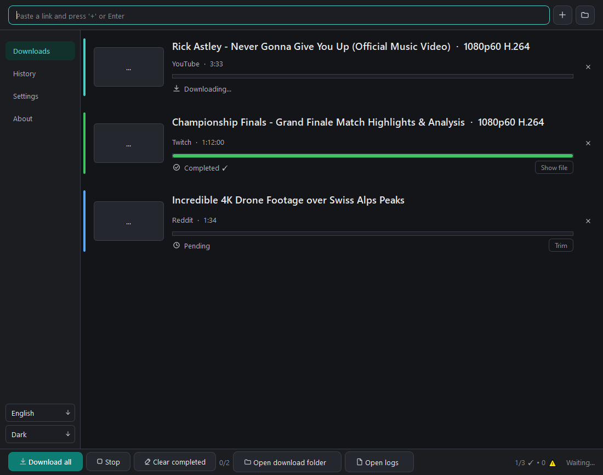
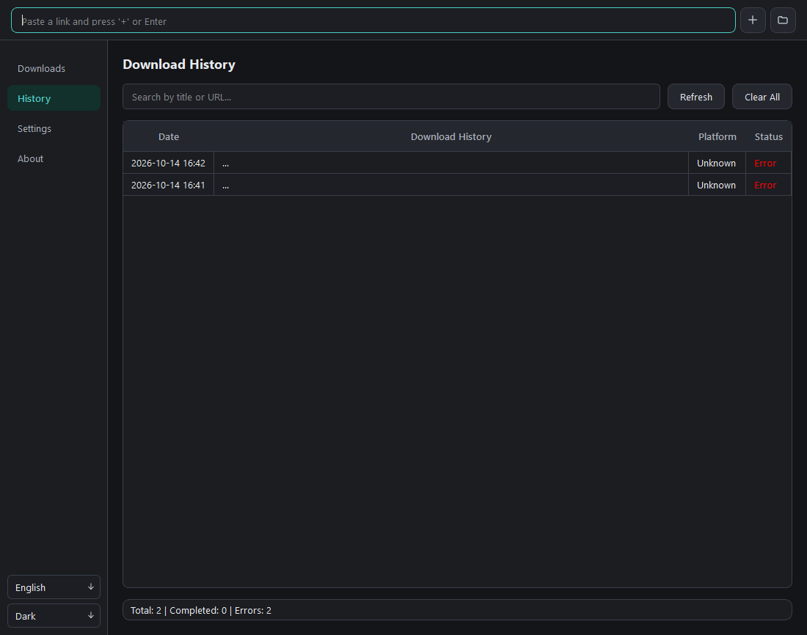
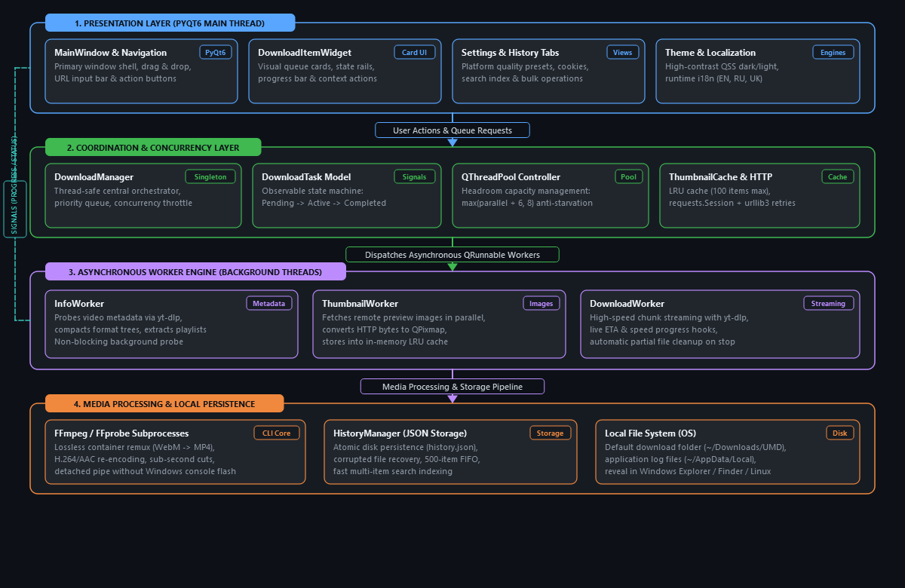

# Universal Media Downloader

<p align="center">
  
</p>

<p align="center">
  <b>Production-grade desktop multimedia downloader, stream inspector, and video processor.</b><br>
  <i>Engineered with Python 3.12+, PyQt6, QThreadPool concurrency, and the yt-dlp streaming core.</i>
</p>

<p align="center">
  <a href="https://github.com/loveinterium228/media-downloader/actions"></a>
  <a href="https://www.python.org/"></a>
  <a href="https://www.riverbankcomputing.com/software/pyqt/"></a>
  <a href="https://github.com/yt-dlp/yt-dlp"></a>
  <a href="https://pytest.org"></a>
  <a href="LICENSE"></a>
  
</p>

<p align="center">
  <a href="#overview">Overview</a> •
  <a href="#system-architecture">Architecture</a> •
  <a href="#engineering-highlights">Engineering Highlights</a> •
  <a href="#features">Features</a> •
  <a href="#supported-platforms">Platforms</a> •
  <a href="#quick-start">Quick Start</a> •
  <a href="#automated-testing">Testing</a> •
  <a href="#building--packaging">Packaging</a> •
  <a href="#license">License</a>
</p>

---

## Overview

**Universal Media Downloader** is a modern, high-performance desktop application engineered for seamless multimedia extraction, stream inspection, and post-processing across 1,000+ web platforms. Designed as an asynchronous, thread-safe application built on **PyQt6**, it orchestrates parallel background tasks via `QThreadPool` without ever blocking the graphical user interface.

Whether downloading raw 4K 60fps streams, extracting pure 192kbps audio tracks, trimming precise millisecond clips, or remuxing multi-track containers into device-ready MP4 formats, Universal Media Downloader provides a clean, responsive workflow.

---

## Screenshots

<p align="center">
  
</p>

<p align="center">
  
</p>

---

## System Architecture

The application adopts a decoupled, event-driven architecture that strictly separates UI state, task lifecycle management, background thread execution, and disk persistence.

<p align="center">
  
</p>

---

## Engineering Highlights

### 1. Concurrency Orchestration & Anti-Starvation
- **Headroom Thread Management**: Dynamic `QThreadPool` scaling reserves worker slots beyond the active download threshold (`max(parallel + 6, 8)`), ensuring metadata lookups and thumbnail downloads are never starved by heavy video downloads.
- **Idempotent Completion Lifecycle**: Fully decoupled task cancellation and completion handling prevents double-decrement race conditions in concurrent task queues.
- **Stop Event Signals**: Cooperative `threading.Event` tokens notify active yt-dlp hooks and subprocesses to abort instantly upon user cancellation, immediately freeing system resources.

### 2. Stream Inspection & Format Compaction
- **Format Tree Filtering**: Heavy multi-megabyte platform metadata dumps are pruned into compact, high-relevance format descriptors (Resolution, FPS, Codec, Audio Presence, Bitrate, Estimated Size).
- **Audio-Safe Selector**: Automatically injects companion audio streams (`{format_id}+bestaudio/{format_id}`) when users choose video-only streams, preventing accidental muted file downloads.

### 3. Subprocess & Media Pipeline Safety
- **Zero Console Flashing**: All external subprocess executions (FFmpeg, FFprobe, Inno Setup, pip) use `subprocess.CREATE_NO_WINDOW` and detached handles to eliminate GUI flickers on Windows.
- **Deadlock-Free Stream Draining**: Child process `stderr` is drained concurrently in a dedicated daemon reader thread, eliminating pipeline buffer deadlocks during long transcode sessions.
- **Process Prioritization**: Windows video processing calls are assigned `BELOW_NORMAL_PRIORITY_CLASS` (0x00004000) so system responsiveness remains smooth during intensive 4K re-encodings.
- **Graceful Fallback**: Video stream downloading operates even without system FFmpeg installed, keeping raw containers when transcode tools are absent.

### 4. Memory-Efficient LRU Thumbnail Cache
- **In-Memory LRU Eviction**: Implements a dedicated least-recently-used thumbnail caching mechanism capped at 100 entries, preventing memory leaks during massive batch playlist imports.
- **HTTP Connection Pooling**: Backed by a unified `requests.Session` configured with `urllib3.util.Retry` exponential backoffs (status codes 429, 500, 502, 503, 504).

### 5. Multi-Lingual Design System & Dynamic Localization
- **Runtime i18n Switching**: Instant locale swapping across English, Russian, and Ukrainian without application reboot.
- **High-Contrast QSS Styling**: Custom Dark and Light theme stylesheet generators compliant with contrast accessibility guidelines.

---

## Features

- **Queue & Priority Management**: Set parallel download limits (1 to 10 simultaneous streams), pause/resume, and retry failed downloads.
- **Lossless & Transcode Processing Modes**:
  - *Lossless Remux*: Swiftly re-encapsulates WebM/MKV into MP4 containers within seconds without quality loss.
  - *Native Pass-Through*: Preserves the exact container streamed from the origin server.
  - *High-Compatibility Re-encoding*: Encodes video streams to H.264/AAC with faststart MP4 flags for legacy hardware.
  - *Audio Extraction*: Extracts pure audio tracks directly to high-bitrate MP3 (192 kbps).
  - *Audio Stripping*: Removes audio channels with zero video re-encoding.
- **Precision Timecode Trimming**: Cut specific video segments with sub-second accuracy (`hh:mm:ss`, `mm:ss`, milliseconds) using stream-seeking flags.
- **Batch Drag & Drop**: Drag web links or `.txt` batch files directly onto the UI to queue hundreds of videos in seconds.
- **Download History & Instant Search**: Full-text search over past downloads with one-click re-download and file revelation in Windows Explorer.
- **Browser Cookies Detection**: Automatically identifies installed browsers (Chrome, Firefox, Edge, Brave, Opera, Vivaldi) to download age-restricted or private media.
- **YouTube EJS & Deno Runtime Detection**: Built-in diagnostics for Deno runtime integration to handle modern YouTube challenge solvers.

---

## Supported Platforms

Seamlessly extracts media from over **1,000+ web platforms** supported by the `yt-dlp` engine:

| Category | Platforms |
| :--- | :--- |
| **Video & Live Streams** | YouTube, Twitch, Kick, Vimeo, RuTube, Facebook Video, X (Twitter), Kinopoisk |
| **Short-Form Content** | TikTok, Instagram Reels & Stories, YouTube Shorts, Reddit Video |
| **Audio & Podcasts** | SoundCloud, Bandcamp, direct stream URLs |

---

## Tech Stack

- **GUI Framework**: [PyQt6](https://www.riverbankcomputing.com/software/pyqt/) (Qt 6.11)
- **Engine Core**: [yt-dlp](https://github.com/yt-dlp/yt-dlp) + [FFmpeg](https://ffmpeg.org/)
- **Networking**: [requests](https://requests.readthedocs.io/) + [urllib3](https://urllib3.readthedocs.io/) (Connection pooling & retries)
- **Testing**: [pytest](https://pytest.org/) + [pytest-qt](https://pytest-qt.readthedocs.io/) (Headless automated test runner)
- **Packaging**: [PyInstaller](https://pyinstaller.org/) + [Inno Setup 6](https://jrsoftware.org/isinfo.php)
- **CI/CD**: GitHub Actions Windows build matrix

---

## Quick Start

### Prerequisites
- **Python 3.10+** (Python 3.12+ recommended)
- **FFmpeg** on system PATH (or placed in `assets/ffmpeg/bin/`)
- *(Optional)* **Deno** 2.0+ for YouTube JavaScript challenge solving

### 1. Clone the repository
```bash
git clone https://github.com/loveinterium228/media-downloader.git
cd media-downloader
```

### 2. Set up a virtual environment
```powershell
# Windows (PowerShell)
python -m venv .venv
.\.venv\Scripts\Activate.ps1

# Linux / macOS
python3 -m venv .venv
source .venv/bin/activate
```

### 3. Install dependencies
```bash
pip install -r requirements.txt
pip install -r requirements-dev.txt
```

### 4. Launch the application
```bash
python main.py
```

---

## Automated Testing

The project maintains a 100% passing automated test suite with **62 comprehensive tests** across 17 test modules covering concurrency safety, timecode parsing, history JSON integrity, real live network streaming, and offscreen Qt workflows:

```powershell
# Run the complete test suite in headless mode
$env:QT_QPA_PLATFORM="offscreen"
pytest tests/ -v
```

### Test Suite Breakdown:
- `test_concurrency_stress.py`: Thread pool high-load queue invariants, race condition resilience, rapid start/stop cycling.
- `test_live_network_streams.py`: Live network metadata extraction and stream chunk download verification with real CC0 media.
- `test_timecode_deep_resilience.py`: Rejection of NaN, Infinity, negative values, and resilient boundary checking.
- `test_ui_advanced_interactions.py`: FormatDialog, TrimDialog, dynamic multilingual card switching, and helper functions.
- `test_download_manager_logic.py`: Queue throttling, concurrent limit enforcement, task completion signals.
- `test_download_manager_bugs.py`: Verifies idempotency and prevents double-decrement race conditions.
- `test_download_worker_pipeline.py`: Task cancellation, progress hook reporting, and partial file cleanup.
- `test_download_task.py`: State machine transitions and format list compaction.
- `test_timecode.py`: Timecode parsing, formatting, boundary checking, and negative offset validation.
- `test_history_stress.py`: File corruption recovery, Unicode serialization, and 500-item FIFO rotation.
- `test_history_manager.py`: CRUD operations, search queries, and bulk deletion performance.
- `test_thumbnail_cache.py`: LRU cache hits, cache misses, and capacity eviction ordering.
- `test_codebase_translations.py`: Codebase AST scan ensuring 100% key parity across `en.json`, `ru.json`, and `uk.json`.
- `test_ui_workflows.py`: Qt headless tests verifying widget instantiation, tab navigation, and settings persistence.
- `test_update_checker_logic.py`: PyPI version parser and update worker error handling.

---

## Building & Packaging

### Create Standalone Executable with PyInstaller
```powershell
pyinstaller --noconfirm --clean UniversalMediaDownloader.spec
```

The compiled portable bundle is generated in `dist/UniversalMediaDownloader/`.

### Create Windows Installer with Inno Setup
```powershell
ISCC.exe /DAppVersion=1.1.0 installer.iss
```

The setup executable is generated in `installer_output/`.

---

## Project Structure

```
media-downloader/
├── .github/workflows/          # GitHub Actions CI/CD workflows
├── app/                        # Main application package
│   ├── about_tab.py            # About dialog, Deno diagnostics & links
│   ├── download_item_widget.py # Individual download card widget
│   ├── download_manager.py     # Thread-safe download queue orchestrator
│   ├── download_task.py        # Task state model & signals
│   ├── flow_layout.py          # Dynamic Qt flow layout for tags
│   ├── format_dialog.py        # Stream format selection dialog
│   ├── history_tab.py          # Download history table & manager
│   ├── links.py                # Project & repository URLs
│   ├── main_window.py          # Primary application window & layout
│   ├── paths.py                # Cross-platform path & asset resolver
│   ├── settings_tab.py         # Application settings & cookie detector
│   ├── theme_manager.py        # QSS dark/light stylesheet manager
│   ├── threads.py              # DownloadWorker, InfoWorker & ThumbnailWorker
│   ├── timecode.py             # Timecode parser & range validator
│   ├── translation.py          # Multi-lingual translation engine
│   ├── trim_dialog.py          # Timestamp cut & trim dialog
│   └── update_checker.py       # Background engine updater
├── assets/                     # Application visual assets
│   ├── animations/             # UI vector graphics (rocket.svg)
│   ├── icons/                  # Light and dark SVG icon sets
│   ├── logos/                  # Platform logo graphics
│   ├── en.json                 # English localization
│   ├── ru.json                 # Russian localization
│   └── uk.json                 # Ukrainian localization
├── screenshots/                # Application preview screenshots
├── tests/                      # Automated test suite (62 tests)
├── installer.iss               # Inno Setup Windows installer configuration
├── LICENSE                     # MIT License
├── main.py                     # Application entry point
├── pytest.ini                  # Pytest test configuration
├── README.md                   # Project documentation
├── requirements.txt            # Production runtime dependencies
├── requirements-dev.txt        # Development & testing dependencies
└── UniversalMediaDownloader.spec# PyInstaller build specification
```

---

## License

This project is licensed under the MIT License - see the [LICENSE](LICENSE) file for details.

Developed with ❤️ by **[loveinterium228](https://github.com/loveinterium228)**.
